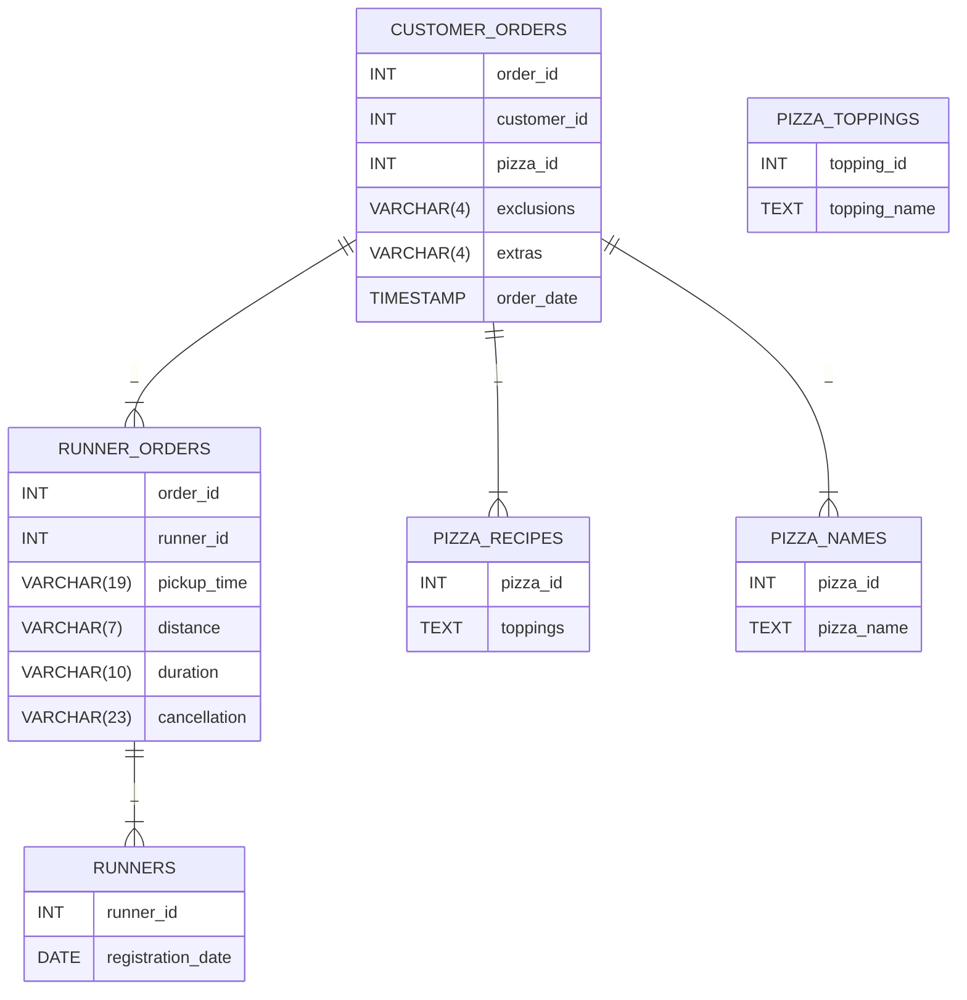

# **Case Study #2 - Pizza Runner**

## Creación de las tablas

Las relaciones entre las tablas se han ajustado a las descritas por el reto, independientemente de que tengan sentido o no. 

* Las tablas para este resto son:
1. Corredores (*Runners*) Guarda information del id del corredor y su fecha de registro
2. Pedidos de los corredores (*Runners_orders*) Guarda el id del pedido y del corredor, el tiempo de recogida, la distancia, la duración y la cancelación 
2. Miembros(*Members*) Guarda el id del cliente y la fecha en que se registro.
3. Ventas(*Sales*) Guarda el cliente que ha realizado la compra, la fecha de compra, el id del producto comprado. Ademas de relacionar las tablas[^1]

### Relaciones
==TODO==


## Diagrama 
[Diagrama de Danny](https://dbdiagram.io/d/Pizza-Runner-5f3e085ccf48a141ff558487)



```sql
CREATE TABLE IF NOT EXISTS runners (
    runner_id INT PRIMARY KEY,
    registration_date DATE
);

CREATE TABLE IF NOT EXISTS runner_orders (
    order_id INT,
    runner_id INT,
    pickup_time VARCHAR(19),
    distance VARCHAR(7),
    duration VARCHAR(10),
    cancellation VARCHAR(23),
    PRIMARY KEY(order_id, runner_id),
    CONSTRAINT `runner_id_fk` FOREIGN KEY (`runner_id`) REFERENCES runners (`runner_id`) ON UPDATE NO ACTION ON DELETE NO ACTION
);
CREATE TABLE IF NOT EXISTS pizza_recipes (pizza_id INT PRIMARY KEY, toppings TEXT);

CREATE TABLE IF NOT EXISTS pizza_toppings (
    topping_id INT PRIMARY KEY,
    topping_name TEXT
);

CREATE TABLE IF NOT EXISTS pizza_names (pizza_id INT PRIMARY KEY, pizza_name TEXT);

CREATE TABLE IF NOT EXISTS customer_orders (
    order_id INT,
    customer_id INT,
    pizza_id INT,
    exclusions VARCHAR(4),
    extras VARCHAR(4),
    order_date TIMESTAMP,
    CONSTRAINT `order_id_fk` FOREIGN KEY (`order_id`) REFERENCES runner_orders (`order_id`) ON UPDATE NO ACTION ON DELETE NO ACTION,
    CONSTRAINT `pizza_id_fk` FOREIGN KEY (`pizza_id`) REFERENCES pizza_names (`pizza_id`) ON UPDATE NO ACTION ON DELETE NO ACTION,
    CONSTRAINT `pizza_id2_fk` FOREIGN KEY (`pizza_id`) REFERENCES pizza_recipes (`pizza_id`) ON UPDATE NO ACTION ON DELETE NO ACTION
);
```

## Carga de datos


```sql
INSERT INTO runners VALUES 
(1, '2021-01-01'),
(2, '2021-01-03'),
(3, '2021-01-08'),
(4, '2021-01-15');

INSERT INTO runner_orders VALUES 
(1,1,'2021-01-01 18:15:34', '20km', '32 minutes', ''),
(2,1,'2021-01-01 19:10:54', '20km', '27 minutes', ''),
(3,1,'2021-01-03 00:12:37', '13.4km', '20 mins', 'NaN'),
(4,2,'2021-01-04 13:53:03', '23.4', '40', 'NaN'),
(5,3,'2021-01-08 21:10:57', '10', '15', 'NaN'),
(6,3,'null', 'null', 'null', 'Restaurant Cancellation'),
(7,2,'2021-01-08 21:30:45', '25km', '25mins', 'null'),
(8,2,'2021-01-10 00:15:02', '23.4 km', '15 minute', 'null'),
(9,2,'null', 'null', 'null', 'Customer Cancellation'),
(10,1, '2021-01-11 18:50:20', '10km', '10minutes', 'null');

INSERT INTO pizza_names VALUES 
(1, 'Meat Lovers'),
(2, 'Vegetarian');

INSERT INTO pizza_recipes VALUES 
(1, '1, 2, 3, 4, 5, 6, 8, 10'),
(2, '4, 6, 7, 9, 11, 12');

INSERT INTO customer_orders VALUES 
(1,101,1,'','','2021-01-01 18:05:02'),
(2,101,1,'','','2021-01-01 19:00:52'),
(3,102,1,'','','2021-01-02 23:51:23'),
(3,102,2,'','NaN','2021-01-02 23:51:23'),
(4,103,1,'4','','2021-01-04 13:23:46'),
(4,103,1,'4','','2021-01-04 13:23:46'),
(4,103,2,'4','','2021-01-04 13:23:46'),
(5,104,1,'null','1','2021-01-08 21:00:29'),
(6,101,2,'null','null','2021-01-08 21:03:13'),
(7,105,2,'null','1','2021-01-08 21:20:29'),
(8,102,1,'null','null','2021-01-09 23:54:33'),
(9,103,1,'4','1, 5','2021-01-10 11:22:59'),
(10,104,1,'null','null','2021-01-11 18:34:49'),
(10,104,1,'2, 6','1, 4','2021-01-11 18:34:49');

INSERT INTO pizza_toppings VALUES 
(1, 'Bacon'),
(2, 'BBQ Sauce'),
(3, 'Beef'),
(4, 'Cheese'),
(5, 'Chicken'),
(6, 'Mushrooms'),
(7, 'Onions'),
(8, 'Pepperoni'),
(9, 'Peppers'),
(10,'Salami'),
(11,'Tomatoes'),
(12,'Tomato Sauce');
```